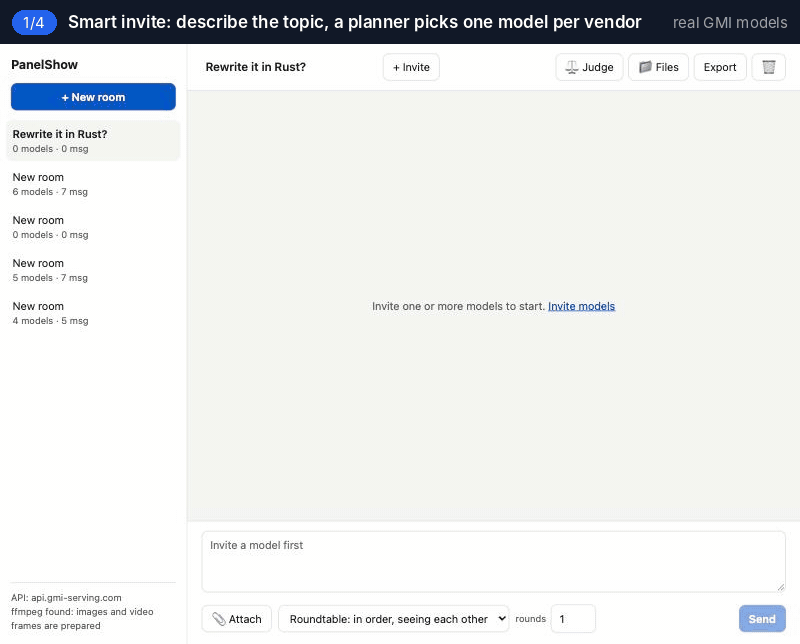
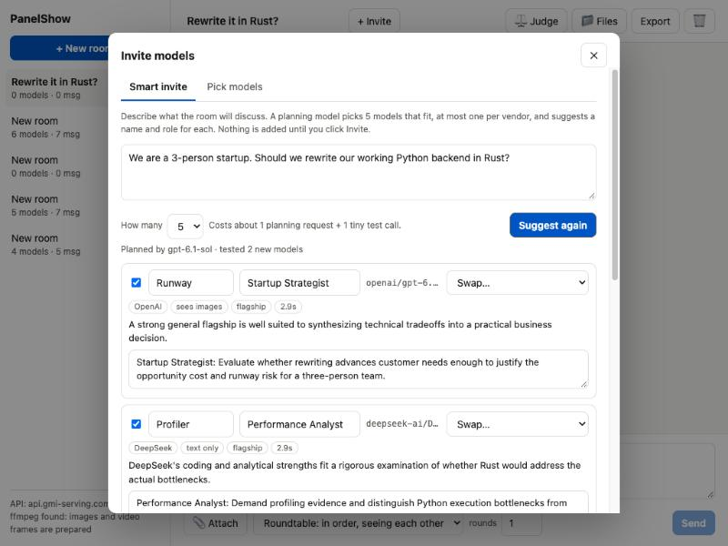
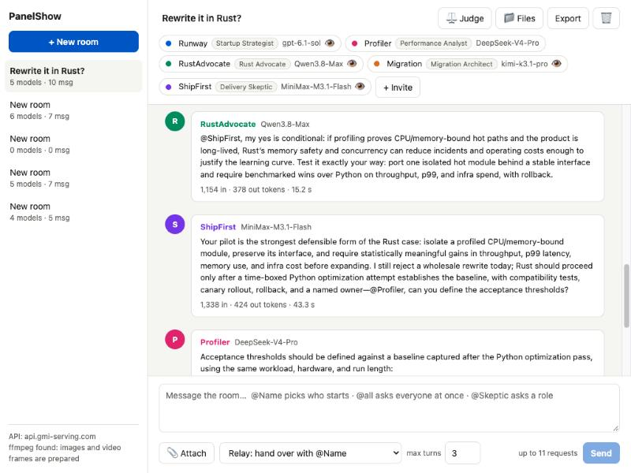
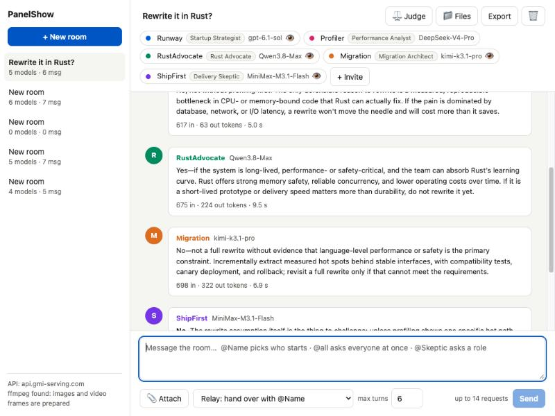
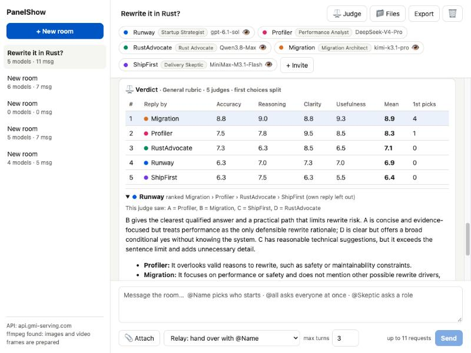
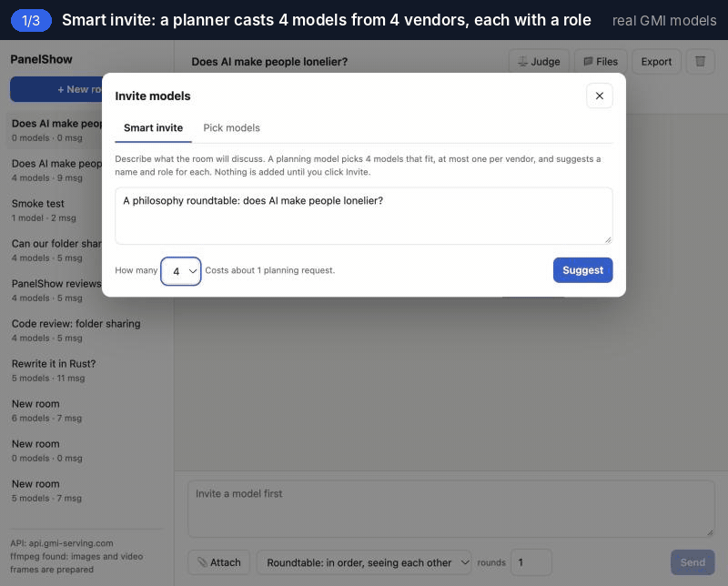
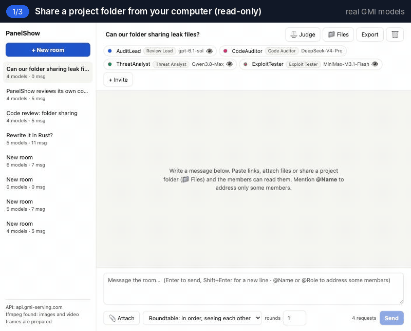

<div align="center">

# PanelShow

**Host your own AI panel show.**<br>
Put several AI models into one discussion. They question each other, choose who speaks next, and review each other's answers anonymously. Models come from GMI Cloud, or run on your own machine with Ollama.

English · [简体中文](README.zh-CN.md)

[](https://github.com/Jyc323/panelshow/actions/workflows/test.yml)
[](LICENSE)


[](https://console.gmicloud.ai/ref/ZPU349MK)



<sub>Recorded with real models on GMI Cloud; only the waiting time is cut. <a href="docs/examples/rewrite-it-in-rust.md">Full transcript</a></sub>

</div>

## Why

A single model tends to agree with whoever is asking, and it can state things that sound right but are wrong (hallucinations). One answer on its own gives you little to judge it by. Sending the same question to several models allows cross-checking, but it means switching between tabs, copying context and comparing the answers by hand, which is slow and easy to get wrong.

PanelShow puts several models into one shared conversation. Each member reads the other members' replies and can point out factual errors, fill in gaps, or hand a question to a better-suited member with `@Name`. A hallucination from one model is more likely to be caught by another, and disagreements show up in the conversation itself. When the discussion is over, members can review each other's answers against a rubric, anonymised and in shuffled order. You, the host, control the topic, the speaking order and when the discussion ends.

## Quick start

```bash
git clone https://github.com/Jyc323/panelshow.git
cd panelshow
npm install
cp .env.example .env    # add your GMI Cloud API key after GMI_API_KEY=
npm start               # then open http://127.0.0.1:8790
```

Without an API key, run `npm run demo` to try the full flow. It uses scripted stand-in models, makes no API calls and costs nothing.

One GMI Cloud API key gives access to every chat model on the platform ([get one here](https://console.gmicloud.ai/ref/ZPU349MK), referral link).

### Local models (Ollama)

PanelShow also works with models that run on your own machine through [Ollama](https://ollama.com), with or without a GMI key. Start Ollama and pull a model or two, then start PanelShow:

```bash
ollama pull qwen3:8b
ollama pull gemma3:4b
npm start
```

PanelShow looks for Ollama at `http://127.0.0.1:11434`. Local models appear in a separate group in the invite list, and a room can mix them with GMI Cloud models.

## Example: one full discussion

Take the session in the GIF above. The question was whether a 3-person startup should rewrite its working Python backend in Rust.

1. **Smart invite** picked one model from each of five vendors and gave each member a role: startup strategist (gpt-6.1-sol), performance analyst (DeepSeek-V4-Pro), Rust advocate (Qwen3.8-Max), migration architect (kimi-k3.1-pro) and delivery skeptic (MiniMax-M3.1-Flash).
2. With **`@all`**, all five answered at the same time without seeing each other's answers. Four were against the rewrite; the Rust advocate gave a conditional yes.
3. In **Relay** mode, the host asked the Rust advocate to convince the delivery skeptic. The advocate narrowed its proposal to a pilot migration of a single module. The skeptic accepted the pilot and asked the performance analyst to define the acceptance thresholds.
4. Finally, five judges **reviewed** the anonymised answers. The migration architect ranked first with 8.9/10. The longest answer ignored the three-sentence limit and ranked last.

<table>
<tr>
<td width="50%"><br><sub>The panel proposed by Smart invite. Each member can be unticked, renamed or swapped.</sub></td>
<td width="50%"><br><sub>In Relay mode, members hand the floor on with <code>@Name</code>.</sub></td>
</tr>
<tr>
<td width="50%"><br><sub>With <code>@all</code>, every member answers independently and cannot see the others.</sub></td>
<td width="50%"><br><sub>The verdict shows per-criterion scores and each judge's reasoning.</sub></td>
</tr>
</table>

## Features

### Smart invite

Describe the topic, and a stable mainstream model acting as planner proposes 3 to 6 members, at most one per vendor, each with a name, a role and the reason it was picked. Candidates must first pass two small checks: whether the model returns an answer at all, and whether a model that claims image input can actually recognise an image. Models that fail are left out of the proposal. Nothing is added until you confirm. You can also skip the proposal and pick several models from the list by hand.

### Three turn-taking modes

<p align="center"><br><sub>Roundtable mode, recorded live: four models on GMI Cloud discuss whether AI makes people lonelier and push back on each other by name in round 2. <a href="docs/examples/does-ai-make-people-lonelier.md">Full transcript</a></sub></p>

| Mode | Rules |
|---|---|
| Roundtable | Members speak in a fixed order for 1 to 5 rounds, and each sees everything said before. A member can reply `PASS`; the discussion ends when all members pass. |
| Parallel | All members answer at the same time without seeing each other. Useful for collecting independent first opinions. |
| Relay | One member speaks at a time. When a reply contains `@Name`, the floor passes to that member, up to a limit on total turns. |

In any mode, you can choose who answers with @:

| You write | Who answers |
|---|---|
| `@Name` | that member |
| `@Skeptic`, `@fact-checker`, `@版权审查员` … | every member with that role |
| `@all` | all members. In Relay mode they first answer independently, then the floor returns to whoever asked |

### Blind judge

Choose the replies to review, the judges, and a rubric (General, Writing, Code, Research, or your own criteria). Judges see the candidate replies as A, B, C in shuffled order, with member names and model ids removed, and no judge reviews its own reply. The verdict lists the mean score per criterion, first-place votes, each judge's ranking and reasoning, and which member wrote each candidate.

### Read your local project (read-only)

In 📁 Files, enter a folder path such as `~/code/my-app`. Members receive the project's file tree and can read a whole file or a line range (`@@read my-app/src/app.js:120-200`), search the whole project (`@@search parseConfig`), or list a directory (`@@list my-app/src`). Results come with line numbers, so findings can point to a specific file and line.

PanelShow never writes to a shared folder. The following are never shown to models: sensitive files such as `.env`, keys and credentials; dependency and build folders; binary files; symbolic links; and anything excluded by `.gitignore` or `.panelshowignore`. Values in files that look like passwords or tokens are replaced with `[redacted]`. Members see only the folder's name, not its full path on your machine.

<p align="center"><br><sub>Recorded live: four models on GMI Cloud review PanelShow's own folder-sharing feature.</sub></p>

> **PanelShow reviewing PanelShow: two rounds of code review.** We shared this repository with four models (gpt-6.1-sol, DeepSeek-V4-Pro, Qwen3.8-Max, MiniMax-M3.1-Flash) and asked them to check whether folder sharing could leak files.
> - **Round 1:** DeepSeek-V4-Pro found that a *hard link* inside the shared folder could expose a file outside it; gpt-6.1-sol pointed out that secrets can sit in files with ordinary names.
> - **Round 2** ran on the fixed code. gpt-6.1-sol found that *directories* with secret-like names (such as `secrets/`) were still read; Qwen3.8-Max found that the read endpoint did not check where a request came from, that the shared root itself was not re-checked, and that uploaded files were not redacted.
>
> All of these issues are fixed and covered by tests. Each round took a few minutes and a few dozen requests.

### Links, attachments and shared files

- Links in a message are opened on the server. Web pages are reduced to their main text, and members that accept images also get up to 3 pictures. PDF and Word documents are converted to text. A direct video link becomes one contact sheet of 12 frames (requires ffmpeg). For YouTube links, the title, description and captions are read.
- You can attach text, PDF or Word files to a message.
- Members can write reports, code and data into a shared file area, and request more material with `@@read filename` or `@@open url`.

### Cloud and local models in one room

Members can be GMI Cloud models, local Ollama models, or a mix. Local models are called through Ollama's native API with an explicit context window (`num_ctx`, 16K by default), because Ollama's default window is small enough to cut PanelShow's prompts without an error. Local members run one at a time, so several local models do not compete for memory; in parallel mode they still answer without seeing each other. Smart invite treats each local model family as its own vendor and skips the size limit that applies to cloud models. Without a GMI key, it picks local models by simple rules and sends no planning request.

### Runs locally, few dependencies

PanelShow is one Node server listening on `127.0.0.1` plus one web page. It uses no frontend framework, no build tool and no database; rooms are stored as JSON files. The API key stays in `.env` and is never sent to the browser. Any room can be exported as Markdown.

## Comparison with similar tools

| | Side-by-side chat apps | Council scripts | PanelShow |
|---|:---:|:---:|:---:|
| Ask several models at once | ✓ | ✓ | ✓ |
| Models read and respond to each other's replies | – | one review round | ✓ any number of turns |
| You choose who answers (`@Name`, `@Role`, `@all`) | – | – | ✓ |
| Builds a panel from different vendors automatically | – | – | ✓ |
| Anonymous review against a rubric, with reasons | – | ranking only | ✓ |
| Members read links, PDFs and video frames | partly | – | ✓ |
| Members have read-only access to your local project | – | – | ✓ |

## Configuration

Only the API key is required. Everything else is optional and goes in `.env` (see [`.env.example`](.env.example)).

| Setting | Default | Description |
|---|---|---|
| `GMI_API_KEY` | | GMI Cloud API key |
| `PORT` | `8790` | Local port |
| `PANELSHOW_DIRECTOR_MODEL` | newest GPT / Gemini Pro / Qwen Max / DeepSeek available to your key | Planner model for Smart invite |
| `PANELSHOW_MAX_TOKENS` | `8000` | Maximum output tokens per reply |
| `PANELSHOW_TIMEOUT_MS` | `300000` | Timeout per request; thinking models can be slow |
| `PANELSHOW_AUTO_PROBE` | `1` | `0` skips the two small checks for newly invited models |
| `PANELSHOW_ALLOW_PRIVATE_URLS` | `0` | `1` lets members open localhost and LAN addresses |
| `PANELSHOW_DATA_DIR` | `./data` | Directory where room data is stored |
| `PANELSHOW_OLLAMA_URL` | `http://127.0.0.1:11434` | Address of the Ollama server; `off` disables local models |
| `PANELSHOW_OLLAMA_NUM_CTX` | `16384` | Context window per local request (prompt and reply); larger values need more memory |
| `PANELSHOW_OLLAMA_CONCURRENCY` | `1` | How many local requests run at the same time |

## Cost

Each reply is one billed request. Before you send a message, the composer shows how many requests it will trigger. The session in the GIF used 13 requests (8 replies and 5 judges), plus 1 planning request for Smart invite. The first time Smart invite uses a model, it also sends two very small test requests; the results are cached and not repeated. Local models through Ollama cost nothing per request, and are checked by asking Ollama about the model instead of sending test requests.

## Security and privacy

- The server listens on `127.0.0.1` only. It refuses requests whose `Host` or `Origin` does not match, and API requests that the browser marks as cross-site, including read-only ones.
- The API key is read from the environment and sent only to the GMI endpoint. It is never logged, persisted or returned to the page.
- Members can open public `http(s)` addresses only. Local and private-network addresses are blocked by default.
- Shared folders are read-only. Only files in the scan list can be read; reads do not follow symbolic links and confirm that the opened file is the one the scan found; a folder that is moved or replaced stops being shared. Hard-linked files and files or directories with secret-like names are skipped, and dependencies, binaries and anything excluded by ignore rules are not shared. Credential-like values are redacted, in uploaded files too. Note that what members read is still sent to the model provider, so share only code you are allowed to send.
- Text from web pages and files is given to members as reference material, explicitly marked as not being instructions. This reduces the risk of page content steering a model, but cannot rule it out.
- Files written by members are shown as plain text and never run as web pages.
- Requests to local models go only to the Ollama address set in `.env`; the browser cannot change it. When every member is local, what members read is sent only to that Ollama server.

See [SECURITY.md](SECURITY.md) for the scope of these protections and how to report a security issue.

## Roadmap

- [ ] Other OpenAI-compatible providers, such as OpenRouter and LM Studio (GMI Cloud and Ollama for now)
- [ ] Built-in discussion presets, such as Council, Critique and Debate
- [ ] Costs shown in US dollars, with a budget cap per room
- [ ] Images and 3D models as attachments
- [ ] Share a discussion as a read-only page; export a verdict card as an image
- [ ] Members propose changes to a shared folder as diffs, which you choose whether to apply
- [ ] Sandboxed preview of member-written HTML; members edit each other's files with version history
- [ ] Web search for members; speech-to-text for video

Full roadmap: [TODO.md](TODO.md). Issues and pull requests are welcome.

## Development

```bash
npm test     # 37 end-to-end tests against stand-in GMI and Ollama servers: no API key, no network
npm run demo # run the full app with stand-in models
```

`server/` is the Node server: `llm.js` routes each model call to GMI Cloud (`gmi.js`) or Ollama (`ollama.js`), `orchestrator.js` schedules turns, `casting.js` handles Smart invite, `judge.js` runs the blind judge, and `workspace.js` manages read-only project folders. `web/` is the frontend page, built with Preact + htm and no build step.

## Credits

Built on [GMI Cloud](https://www.gmicloud.ai/), with all models called through one OpenAI-compatible API. Get an API key in the [GMI Cloud console](https://console.gmicloud.ai/ref/ZPU349MK) (referral link).

## Let's connect

Questions, ideas, or want to share how you use PanelShow? I'd love to hear from you:

- X: [@jiayuliiop8](https://x.com/jiayuliiop8)
- LinkedIn: [Jiayu Danielle Li](https://www.linkedin.com/in/jiayu-danielle-li-158102188/)

Issues and pull requests are welcome too.

## License

[MIT](LICENSE)

<div align="center"><sub>If PanelShow is useful to you, a ⭐ helps more people find it.</sub></div>
