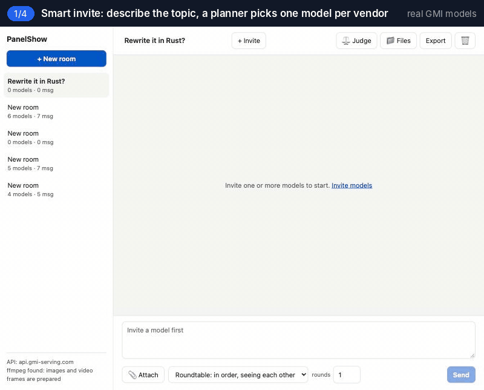
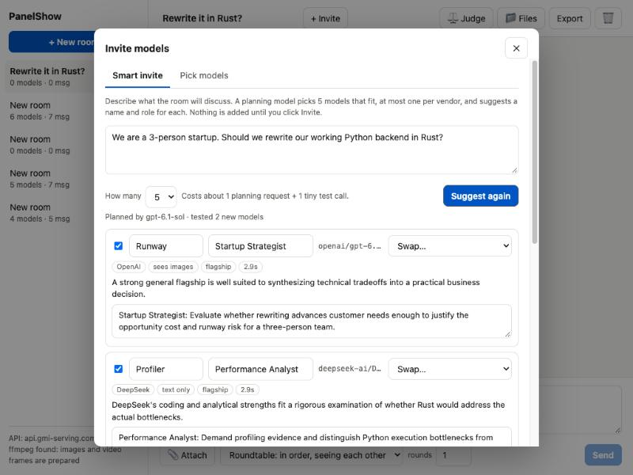
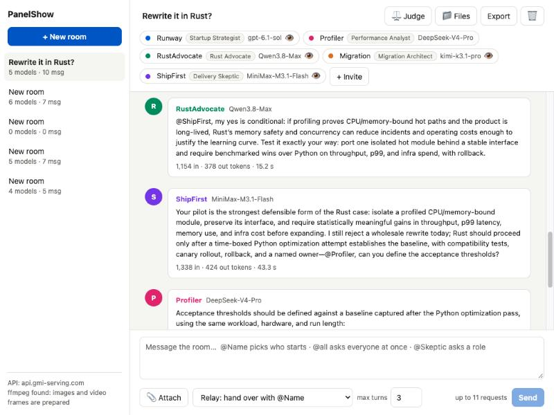
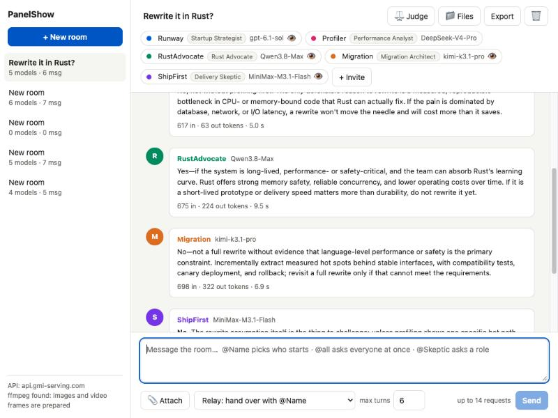
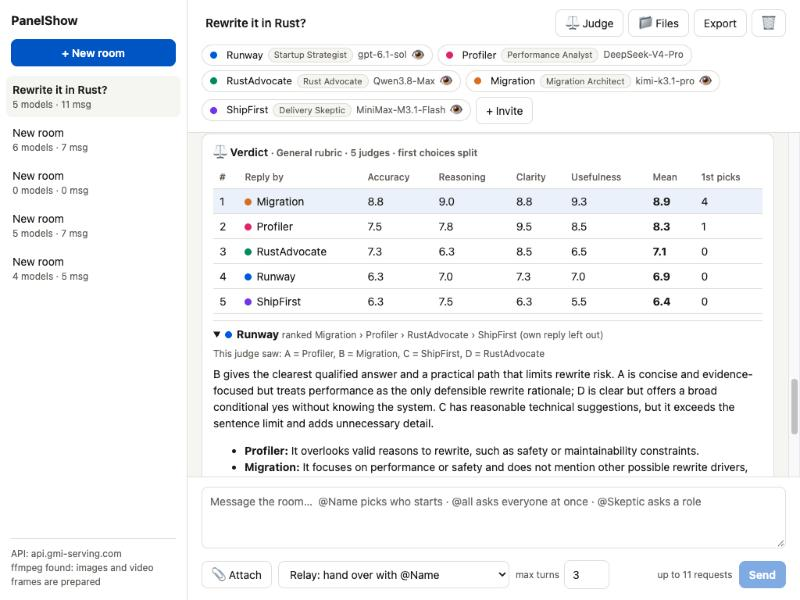
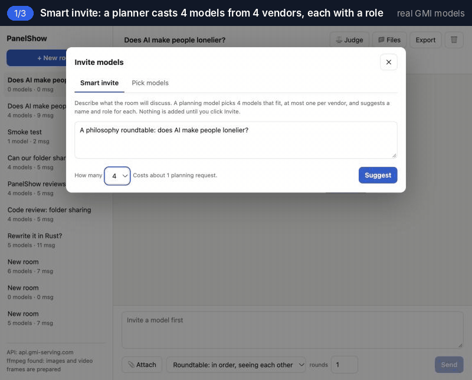
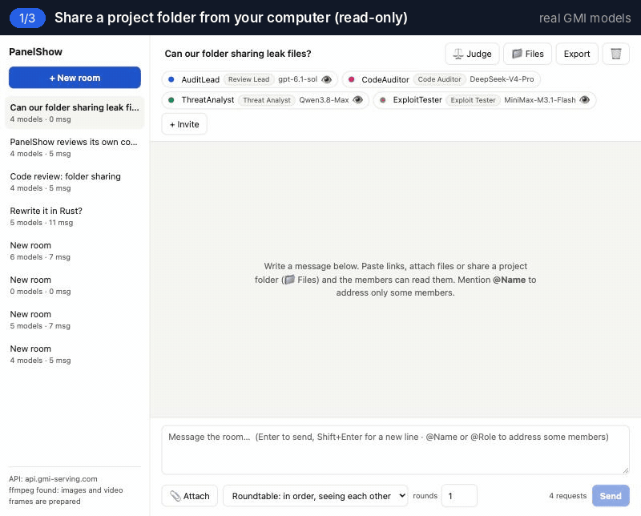

<div align="center">

# PanelShow

**把多个 AI 模型放进同一场讨论，由你主持。**<br>
成员之间可以互相质疑、指定下一位发言者，最后在匿名条件下互相评审。模型由 GMI Cloud 提供。

[English](README.md) · 简体中文

[](https://github.com/Jyc323/panelshow/actions/workflows/test.yml)
[](LICENSE)


[](https://console.gmicloud.ai/ref/ZPU349MK)



<sub>GMI Cloud 真实模型录制，只剪掉了等待的时间。<a href="docs/examples/rewrite-it-in-rust.md">完整对话记录（英文）</a></sub>

</div>

## 为什么做这个

单个模型容易迎合提问者，也可能给出看似合理但实际错误的内容（幻觉），而只看一份回答很难判断它是否可靠。把同一个问题分别发给几个模型能交叉验证，但需要在多个标签页之间切换、复制上下文，再手动逐条比对，耗时且容易遗漏。

PanelShow 把多个模型放进同一个对话上下文。每个成员都能读到其他成员的回答，可以指出事实错误、补充遗漏，或者用 `@Name` 把问题交给更擅长的成员。一个模型的幻觉更容易被其他模型发现，分歧点也会直接呈现出来。讨论结束后，还可以让成员在匿名且打乱顺序的条件下，按评分标准互相评审。主持人（你）控制话题、发言顺序和讨论何时结束。

## 快速开始

```bash
git clone https://github.com/Jyc323/panelshow.git
cd panelshow
npm install
cp .env.example .env    # 在 GMI_API_KEY= 后填入你的 GMI Cloud API key
npm start               # 打开 http://127.0.0.1:8790
```

没有 API key 时，可以运行 `npm run demo` 体验完整流程。该模式使用脚本模拟的模型，不调用 API，也不产生费用。

一个 GMI Cloud API key 即可调用平台上的所有对话模型（[在此获取](https://console.gmicloud.ai/ref/ZPU349MK)，推荐链接）。

## 示例：一场完整的讨论

以上方 GIF 中的对话为例，议题是“一个 3 人创业团队是否应该把运行正常的 Python 后端用 Rust 重写”。

1. **智能邀请**从五家厂商各选出一个模型，并为每个成员分配角色：创业策略师（gpt-6.1-sol）、性能分析师（DeepSeek-V4-Pro）、Rust 支持者（Qwen3.8-Max）、迁移架构师（kimi-k3.1-pro）和交付质疑者（MiniMax-M3.1-Flash）。
2. 通过 **`@all`** 让五个成员同时作答，作答时彼此不可见。四个成员反对重写，Rust 支持者给出了有条件的赞成。
3. 切换到**接力**模式后，主持人请 Rust 支持者说服交付质疑者。Rust 支持者将主张收窄为单个模块的迁移试点；质疑者接受试点方案，并指定性能分析师制定验收标准。
4. 最后由五位评审对匿名化的回答进行**评审**。迁移架构师以 8.9/10 排名第一；篇幅最长的回答因未遵守“最多三句话”的要求排在末位。

<table>
<tr>
<td width="50%"><br><sub>智能邀请生成的推荐阵容，可勾选、重命名或替换。</sub></td>
<td width="50%"><br><sub>接力模式下，成员通过 <code>@Name</code> 移交发言权。</sub></td>
</tr>
<tr>
<td width="50%"><br><sub>使用 <code>@all</code> 时，所有成员独立作答，互不可见。</sub></td>
<td width="50%"><br><sub>评审结果包含分项得分和每位评审的理由。</sub></td>
</tr>
</table>

## 功能

### 智能邀请

输入议题后，由一个稳定的主流模型担任规划者，推荐 3 到 6 名成员，同一厂商最多入选一个模型，每名成员附带名称、角色和入选理由。候选模型需先通过两项轻量测试：能否正常返回回答，以及声明支持图像输入的模型能否真正识别图片。未通过测试的模型不会进入推荐列表。所有推荐都需要你确认后才会生效。也可以跳过推荐，从模型列表中手动多选。

### 三种发言模式

<p align="center"><br><sub>圆桌模式真实录制：GMI Cloud 上的四个模型讨论“AI 是否让人更孤独”，第二轮按名字互相反驳。<a href="docs/examples/does-ai-make-people-lonelier.md">完整对话记录（英文）</a></sub></p>

| 模式 | 规则 |
|---|---|
| 圆桌（Roundtable） | 成员按顺序发言，可设置 1 到 5 轮，每位成员都能看到此前的全部内容。成员可以回复 `PASS`，全部成员 PASS 时讨论结束。 |
| 并行（Parallel） | 所有成员同时作答，彼此不可见，适合收集相互独立的初始判断。 |
| 接力（Relay） | 每次只有一名成员发言。回答中出现 `@Name` 时，发言权移交给该成员，总轮数有上限。 |

在任意模式下，都可以通过 @ 指定回答对象：

| 写法 | 回答对象 |
|---|---|
| `@Name` | 指定成员 |
| `@Skeptic`、`@fact-checker`、`@版权审查员`…… | 担任该角色的所有成员 |
| `@all` | 全部成员。在接力模式下，所有成员先独立作答，随后发言权交回提问者 |

### 匿名评审

选择待评审的回答、评审成员和评分标准（通用、写作、代码、研究或自定义）。评审看到的候选回答以 A、B、C 标记并打乱顺序，成员名称和模型 id 均已移除，评审也不会评价自己的回答。评审结果包括各项标准的平均分、第一名票数、每位评审的排名与理由，以及每个候选对应的成员。

### 读取本地项目代码（只读）

在 📁 Files 中填写文件夹路径，例如 `~/code/my-app`。成员会获得项目的目录结构，并可按需读取完整文件或指定行范围（`@@read my-app/src/app.js:120-200`）、在整个项目中搜索（`@@search parseConfig`），或列出指定目录（`@@list my-app/src`）。读取结果带有行号，因此成员给出的意见可以精确到文件和行。

PanelShow 不会对共享文件夹做任何写入。以下内容不会提供给模型：`.env`、密钥和凭据等敏感文件，依赖和构建目录，二进制文件，符号链接，以及被 `.gitignore` 或 `.panelshowignore` 排除的内容。文件中疑似密码或 token 的值会替换为 `[redacted]`。成员只能看到文件夹名称，无法获知其在本机上的完整路径。

<p align="center"><br><sub>真实录制：GMI Cloud 上的四个模型审查 PanelShow 自身的文件夹共享功能。</sub></p>

> **用 PanelShow 审查 PanelShow：两轮代码审查。** 我们将本仓库共享给四个模型（gpt-6.1-sol、DeepSeek-V4-Pro、Qwen3.8-Max、MiniMax-M3.1-Flash），请它们检查文件夹共享功能是否存在文件泄露风险。
> - **第一轮**，DeepSeek-V4-Pro 指出共享文件夹中的*硬链接*可能导致文件夹外的文件被读取；gpt-6.1-sol 指出密钥可能存放在名称普通的文件中。
> - **第二轮**针对修复后的代码进行。gpt-6.1-sol 发现名称像密钥的*目录*（如 `secrets/`）仍会被读取；Qwen3.8-Max 指出读取接口未校验请求来源、共享根目录本身未被重新校验，以及上传文件未做脱敏处理。
>
> 上述问题均已修复并补充了测试。每轮审查耗时几分钟，消耗几十次请求。

### 链接、附件与共享文件

- 消息中的链接由服务器端打开。网页提取正文；支持图像的成员额外获得最多 3 张图片；PDF 和 Word 文档转换为文本；视频直链抽取 12 帧拼成一张图（需要 ffmpeg）；YouTube 链接读取标题、简介和字幕。
- 发送消息时可附带文本、PDF 或 Word 文件。
- 成员可以将报告、代码和数据写入共享文件区，也可以通过 `@@read 文件名` 或 `@@open 链接` 主动获取更多资料。

### 本地运行，依赖精简

PanelShow 由一个监听 `127.0.0.1` 的 Node 服务和一个网页组成，不依赖前端框架、构建工具或数据库，房间数据以 JSON 文件保存。API key 只保存在 `.env` 中，不会发送到浏览器。所有房间都可以导出为 Markdown。

## 与同类工具对比

| | 并排对比类应用 | council 类脚本 | PanelShow |
|---|:---:|:---:|:---:|
| 同时向多个模型提问 | ✓ | ✓ | ✓ |
| 模型能读取并回应彼此的回答 | – | 仅一轮互评 | ✓ 不限轮数 |
| 由用户指定回答对象（`@Name`、`@角色`、`@all`） | – | – | ✓ |
| 自动组建跨厂商的模型阵容 | – | – | ✓ |
| 按评分标准匿名评审并给出理由 | – | 仅排名 | ✓ |
| 成员可读取链接、PDF 和视频帧 | 部分支持 | – | ✓ |
| 成员可只读访问本地项目 | – | – | ✓ |

## 配置

除 API key 外，其余配置均为可选，写在 `.env` 中（参考 [`.env.example`](.env.example)）。

| 配置项 | 默认值 | 说明 |
|---|---|---|
| `GMI_API_KEY` | | GMI Cloud API key |
| `PORT` | `8790` | 本地监听端口 |
| `PANELSHOW_DIRECTOR_MODEL` | 当前 key 可用的最新 GPT / Gemini Pro / Qwen Max / DeepSeek | 智能邀请使用的规划模型 |
| `PANELSHOW_MAX_TOKENS` | `8000` | 单条回答的最大输出 token 数 |
| `PANELSHOW_TIMEOUT_MS` | `300000` | 单次请求超时时间；思考型模型响应可能较慢 |
| `PANELSHOW_AUTO_PROBE` | `1` | 设为 `0` 时，跳过对新邀请模型的两项轻量测试 |
| `PANELSHOW_ALLOW_PRIVATE_URLS` | `0` | 设为 `1` 时，允许成员访问 localhost 和局域网地址 |
| `PANELSHOW_DATA_DIR` | `./data` | 房间数据的存储目录 |

## 费用

每条回答对应一次计费请求。发送消息前，输入框旁会显示本次将触发的请求数。GIF 中的对话共产生 13 次请求（8 条回答和 5 位评审），智能邀请的规划额外消耗 1 次。智能邀请首次使用某个模型时，还会发起两次极小的测试请求，测试结果会被缓存，之后不再重复。

## 安全与隐私

- 服务仅监听 `127.0.0.1`，并拒绝 `Host` 或 `Origin` 不匹配的请求，以及浏览器标记为跨站的 API 请求（包括只读请求）。
- API key 从环境变量读取，仅发送至 GMI 的接口，不会被记录、持久化或返回给前端。
- 成员只能访问公开的 `http(s)` 地址，本机和内网地址默认禁止访问。
- 共享文件夹为只读。只有扫描清单中的文件可以读取；读取时不跟随符号链接，并校验打开的文件与扫描时一致；文件夹被移动或替换后停止共享。存在硬链接的文件、名称像密钥的文件和目录均会跳过，依赖、二进制文件以及被忽略规则排除的内容也不会共享。疑似凭据的值会被脱敏，上传的文件同样适用。请注意，成员读取的内容仍会发送给模型服务商，请只共享可以对外发送的代码。
- 网页和文件中的文字会作为参考资料提供给成员，并明确标注其不是指令。这可以降低网页内容操纵模型的风险，但无法完全消除。
- 成员生成的文件以纯文本形式展示，不会作为网页执行。

防护范围和安全问题的报告方式见 [SECURITY.md](SECURITY.md)。

## 路线图

- [ ] 支持其他 OpenAI 兼容接口，如 OpenRouter、Ollama、LM Studio（目前仅支持 GMI Cloud）
- [ ] 内置讨论预设，如议会、点评、辩论
- [ ] 以美元显示费用，并支持按房间设置预算上限
- [ ] 支持图片和 3D 模型附件
- [ ] 将对话分享为只读页面，将评审卡片导出为图片
- [ ] 成员以 diff 形式对共享文件夹提出修改，由用户决定是否应用
- [ ] 在沙箱中预览成员生成的 HTML；成员可修改彼此的文件并保留版本历史
- [ ] 成员联网搜索；视频语音转文字

完整路线图见 [TODO.md](TODO.md)。欢迎提交 issue 和 PR。

## 开发

```bash
npm test     # 29 个端到端测试，基于模拟的模型服务运行，无需 API key，也无需联网
npm run demo # 使用模拟模型运行完整应用
```

`server/` 为 Node 服务端：`orchestrator.js` 负责发言调度，`casting.js` 负责智能邀请，`judge.js` 负责匿名评审，`workspace.js` 负责只读项目文件夹。`web/` 为前端页面，基于 Preact + htm，无需构建。

## 致谢

本项目基于 [GMI Cloud](https://www.gmicloud.ai/) 构建，所有模型通过同一个 OpenAI 兼容接口调用。API key 可在 [GMI Cloud 控制台](https://console.gmicloud.ai/ref/ZPU349MK)获取（推荐链接）。

## 许可证

[MIT](LICENSE)

<div align="center"><sub>如果 PanelShow 对你有帮助，欢迎点个 ⭐，让更多人看到它。</sub></div>
